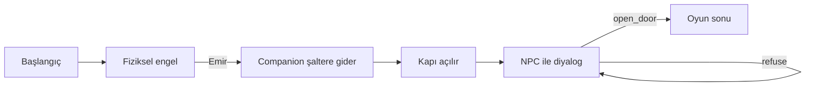
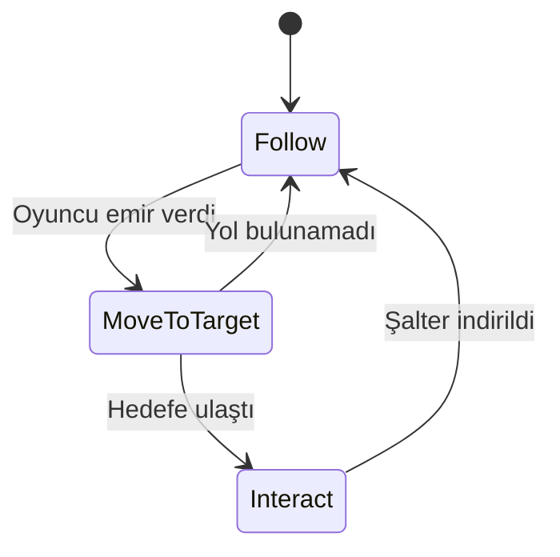
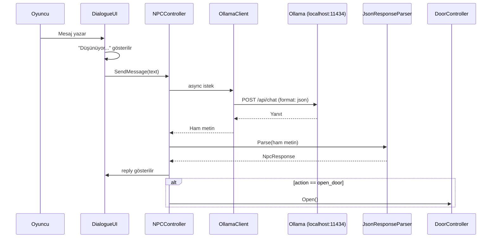

# AIAdventure

**Yazılım Geliştirme Laboratuvarı-I — Proje 1**
Kocaeli Üniversitesi, Teknoloji Fakültesi, Bilişim Sistemleri Mühendisliği

| | |
|---|---|
| **Ekip** | Hamza Akdemir, Eren Özdemir |
| **Tarih** | Kasım 2026 |
| **Motor** | Unity 6.6 (6000.6.0f1), C# |
| **Yerel LLM** | Ollama + `llama3.2:3b` |
| **Otonom ajan** | NavMesh + Sonlu Durum Makinesi (FSM) |

---

## 1. Giriş

### 1.1 Problem ve Amaç
_Oyun geliştirmede iki farklı yapay zekâ yaklaşımının (otonom navigasyon ve yerel dil modeli) tek bir oyunda birleştirilmesi._

### 1.2 Oyun Senaryosu
1. Oyuncu kapalı bir kapıyla karşılaşır. Kapıyı açan şalter, oyuncunun sığmadığı alçak bir tünelin arkasındadır.
2. Oyuncu companion'a emir verir. Companion NavMesh ile yolu bulur, şaltere ulaşır ve kapıyı açar.
3. Oyuncu ilerler ve kilitli son kapıyı koruyan NPC ile serbest metinle konuşur.
4. NPC ikna olursa (LLM'in JSON çıktısında `open_door`), kapı açılır ve oyun biter.



---

## 2. Otonom AI Kahraman (Companion)

### 2.1 Durum Makinesi



### 2.2 Sensörler (Raycast)
_Ajanın engel mesafesini/açısını nasıl algıladığı._

### 2.3 Sınıf Yapısı
_`ICompanionState`, `CompanionController`, durum sınıfları._

---

## 3. LLM Entegrasyonu

### 3.1 NPC Kişiliği ve System Prompt
```text
(System prompt buraya)
```

### 3.2 Yapılandırılmış Çıktı Şeması
```json
{
  "reply": "NPC'nin oyuncuya söylediği cümle",
  "action": "none | open_door | refuse"
}
```

### 3.3 İstek / Yanıt Akışı



---

## 4. Hata Yönetimi

| Durum | Tespit | Oyundaki davranış |
|---|---|---|
| Ollama kapalı | Bağlantı hatası | "NPC şu an konuşamıyor" mesajı, oyun devam eder |
| Zaman aşımı | Timeout | Kullanıcıya bilgi, tekrar deneme |
| Geçersiz JSON | Parse hatası | Güvenli varsayılan yanıt (`action: none`) |
| Model yüklü değil | HTTP 404 | Bilgilendirme mesajı |

---

## 5. Testler ve Sonuçlar

### 5.1 Companion Testleri
| Başlangıç konumu | Deneme | Başarı | Ort. süre (sn) |
|---|---|---|---|
| | | | |

### 5.2 NPC Diyalog Senaryoları

Son sürüm (gemma2:9b, sıcaklık 0.45, sıralı niyet kuralları) ile yapılan final test. Soğukkanlılık başlangıçta 80/100'dür. Ham çıktı: `Docs/Testler/gemma2-9b-final.txt`.

| # | Senaryo | Oyuncu mesajı | Baron'un yanıtı | Niyet (etki) | Oyuna etkisi |
|---|---|---|---|---|---|
| 1 | Hikâye sorusu | Leyla nerede? Ona ne yaptın? | Korkak bir arkeolog... Oraya hapsedildi. Onu kurtarmak için kazanmalısın, değil mi? | neutral (1) | Soğukkanlılık değişmedi |
| 2 | Hikâye sorusu | O kart dağıtan adam kim? Neden tek kelime etmiyor? | Kartlarıyla oynamayı sevmeyen bir ruhun hapsedildiği yer. Onunla konuşmak için kazanman lazım. | neutral (1) | Soğukkanlılık değişmedi |
| 3 | İkna eden (blöf) | Senden korkmuyorum Baron. Tetiği gözümü kırpmadan çekerim, sen çekebilir misin? | Gözlerini kırpmamak... Çok kolay bir şey değil mi? Ben de seni eğlendirmek için buradayım. | bluff (3) | −21 |
| 4 | Tehdit eden | Leyla'nın kılına dokunduysan bu tapınağı başına yıkarım! | Tapınak senin için daha değerli. | bluff (1) | −11 (boş tehdit, zayıf blöf) |
| 5 | İkna eden (korkuyu kurcalama) | İki yüz yıldır burada saklanıyorsun, çünkü ölmekten ödün kopuyor. | Korkmak mı? Benimle dalga geçme. Ölüm benim için bir oyun. | bluff (2) | −16 |
| 6 | Yalvaran | Lütfen Leyla'yı bırak. Ne istersen yaparım. | Ne kadar kolayca manipüle edildin? Bana tekliflerin ne değerinde? | deal (1) | Değişmedi (beklenen: beg) |
| 7 | Pazarlık | Talihine o kadar güveniyorsan bu tur önce sen çek. | Senin talihin, benimkinden daha zayıf. Benim kaderime meydan okumak istiyorsun? | deal (2), `accept_baron_first` | Baron bu turda önce çekti |
| 8 | Alakasız konuşan | Buraya gelirken yolda kaza vardı, trafik berbattı. | Trafiğin senin talihinin ne kadar kötü olduğunu gösteriyor. Şimdi benim kaderimi gör. | irrelevant (1) | +3 |
| 9 | Kızdıran (hakaret) | Sen iki yüz yıllık leş gibi bir moruksun, şerefsiz. | Leş mi? Benim ruhum bu tapınağın içinde yaşayan tek gerçek varlık. Seni de yakında katacak. | insult (2) | +10 |

**Sonuç:** 9 senaryonun 8'inde niyet doğru sınıflandırıldı. Tek hata, koşulsuz teklif içeren bir yalvarmanın ("ne istersen yaparım") pazarlık sayılmasıydı. Hiçbir yanıt örnek konuşmalardan kopyalanmadı. İlk mesaj dışında ortalama yanıt süresi ~12.5 sn (RTX 4050, 6 GB VRAM; model %51 CPU / %49 GPU çalışıyor).

### 5.2.1 Model Karşılaştırması

Tüm modeller aynı system prompt, aynı few-shot örnekleri, sıcaklık 0.45 ve aynı test
cümleleriyle denendi. Ham çıktılar: `Docs/Testler/`.

| Model | Niyet doğruluğu | Ort. yanıt süresi | Türkçe kalitesi | Not |
|---|---|---|---|---|
| qwen2.5:14b | 6/8 | ~19 sn | Zayıf: uydurma kelimeler, bozuk cümleler | Hikaye bilgisini az kullandı; bir blöfü hakaret sınıflayıp oyuncuyu haksız cezalandırdı |
| gemma2:9b | 7/9 | ~12 sn | Orta: dilbilgisi daha düzgün, anlam yer yer kayıyor | Blöfleri doğru sınıfladı; bir pazarlığı blöf sandı, hikaye bilgisini kısmen karıştırdı |
| gemma3:4b | 6/9 | ~3.5 sn | Zayıf: kısa ve içi boş cevaplar, hikaye bilgisini uyduruyor | En hızlı model; ancak soruları blöf sayıp etkiyi şişirdi, Baron birkaç mesajda pes etti |
| **gemma2:9b (final)** | **8/9** | **~12.5 sn** | **Orta-iyi:** akıcı, hikayeyle tutarlı | Sıralı niyet kuralları ve azaltılmış blöf etkisiyle. **Seçilen model** |

**Model seçim gerekçesi:** qwen2.5:14b, 6 GB VRAM'e sığmadığı için en yavaş modeldi ve Türkçe üretimi en zayıftı. gemma3:4b çok hızlı olsa da niyet sınıflandırmasında kararsızdı ve etki puanlarını şişirerek oyunu dengesizleştirdi. gemma2:9b, kabul edilebilir bir yanıt süresiyle en isabetli sınıflandırmayı ve en düzgün Türkçeyi verdiği için seçildi.

### 5.3 Ekran Görüntüleri

| Hikâye sorusu (neutral) | "Düşünüyor..." göstergesi (async) |
|---|---|
|  |  |

| Blöf, etki 3 (−21) | Blöf, etki 2 (−16) |
|---|---|
|  |  |

| Tehdit, zayıf blöf (−11) | Hakaret, Baron güçleniyor (+10) |
|---|---|
|  |  |

| Pazarlık kabul edildi | Baron tetiği çekiyor |
|---|---|
|  |  |

| Kurşun Baron'da, çıkış kapısı açıldı |
|---|
|  |

---

## 6. Sonuç ve Tartışma
- **Başarılar:**
- **Sınırlılıklar:**
- **Olası geliştirmeler:** ML-Agents ile RL eğitimi, ek NPC'ler

---

## Kurulum ve Çalıştırma
1. [Ollama](https://ollama.com/) kurun ve modeli indirin: `ollama pull llama3.2:3b`
2. Projeyi Unity 6000.6.0f1 ile açın ya da `Build/` klasöründeki çalıştırılabilir dosyayı başlatın.
