# AIAdventure — Talih Tapınağı

**Yazılım Geliştirme Laboratuvarı-I — Proje 1**
Kocaeli Üniversitesi, Teknoloji Fakültesi, Bilişim Sistemleri Mühendisliği

| | |
|---|---|
| **Ekip** | Hamza Akdemir, Eren Özdemir |
| **Tarih** | Kasım 2026 |
| **Motor** | Unity 6.6 (6000.6.0f1), C# |
| **Yerel LLM** | Ollama + `gemma2:9b` |
| **Otonom ajan** | NavMesh + Sonlu Durum Makinesi (FSM) + Raycast sensör |

---

## 1. Giriş

### 1.1 Problem ve Amaç
Projenin amacı, oyun geliştirmede iki farklı yapay zekâ yaklaşımını tek bir oyunda birleştirmektir:
**otonom navigasyon** (oyuncunun emriyle kendi yolunu bulup engeli aşan bir yardımcı karakter) ve
**yerel dil modeli** (oyuncuyla serbest metinle konuşan, kararları oyun durumunu değiştiren bir NPC).
Model internete çıkmadan, oyuncunun bilgisayarında Ollama üzerinden çalışır.

### 1.2 Oyun Senaryosu
İki yüz yıl önce her şeyini kaybeden kumarbaz aristokrat **Baron Mortis**, unutulmuş bir talih tapınağında
bir daha asla kaybetmemeyi diledi. Dilek kabul edildi, ama kaybetmeyen ölemez, ölemeyen de tapınaktan çıkamaz.
Arkeolog **Leyla** tapınağa gelip Baron'la oynamayı reddedince arka odaya kapatıldı. Oyuncu, Leyla'nın sevgilisi
**Mecnun**'dur ve onu kurtarmaya gelir.

1. **Giriş:** Tapınağın kapısında bir tilki (**Fox**) bekler. Oyuncu ona yem verir, tilki yardımcısı olur.
   Parmaklığı açan şalter, oyuncunun sığmadığı bir deliğin arkasındadır; oyuncunun emriyle Fox NavMesh ile
   yolu bulur ve şalteri indirir.
2. **Mahzen:** Koridordaki notlar tapınağın hikâyesini anlatır.
3. **Avlu:** Baron'un eski kâhyası **Kâtip**, blackjack masasında kart dağıtır. Kazanan Baron'un kapısından geçer.
4. **Baron'un odası:** Rus ruleti. Oyuncu tetiği çekmeden önce Baron'la serbest metinle konuşur. Dil modeli
   oyuncunun niyetini sınıflandırır; oyun kuralları buna göre Baron'un **soğukkanlılığını** değiştirir.
   Soğukkanlılığı çöken Baron tetiği çekemez ya da pes eder ve çıkış kapısı açılır.
5. **Son:** Mecnun ve Leyla kavuşur.

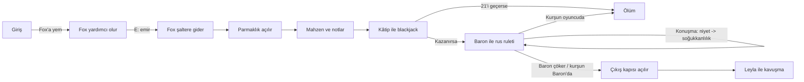

---

## 2. Otonom AI Kahraman (Companion)

### 2.1 Durum Makinesi
Fox'un davranışı `ICompanionState` arayüzünü uygulayan durum sınıflarıyla yönetilir. Hareketin tamamı
NavMesh yol bulmasıyla yapılır; önceden yazılmış bir rota yoktur.

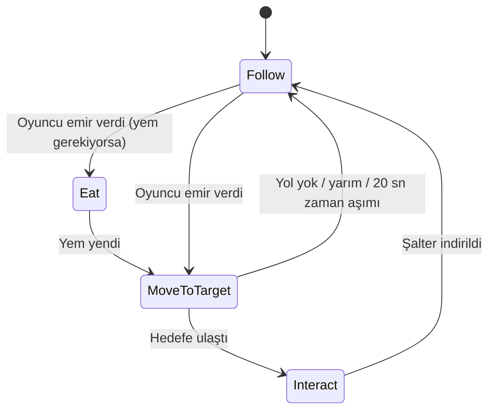

| Durum | Davranış |
|---|---|
| `FollowState` | Oyuncuyu belli bir mesafeden takip eder; uzaklaşınca koşar, yaklaşınca yürür. |
| `EatState` | Oyuncunun verdiği yemi yer, sonra hedefe yönelir. |
| `MoveToTargetState` | NavMesh ile hedefe yol hesaplar. Yol bulunamazsa, yarımsa ya da 20 sn'de varamazsa vazgeçip takibe döner. |
| `InteractState` | Hedefe döner, şalteri indirir, takibe döner. |

### 2.2 Sensörler (Raycast)
`CompanionSensor`, Fox'un önüne 90° açılı bir yelpaze halinde **5 ışın** (3 m menzil) atar ve en yakın engelin
mesafesini ve açısını ölçer. Engel yaklaştıkça Fox yavaşlar (`ApplySensorSpeed`), böylece dar geçitlerde ve
duvar kenarlarında çarpmadan ilerler.

### 2.3 Sınıf Yapısı

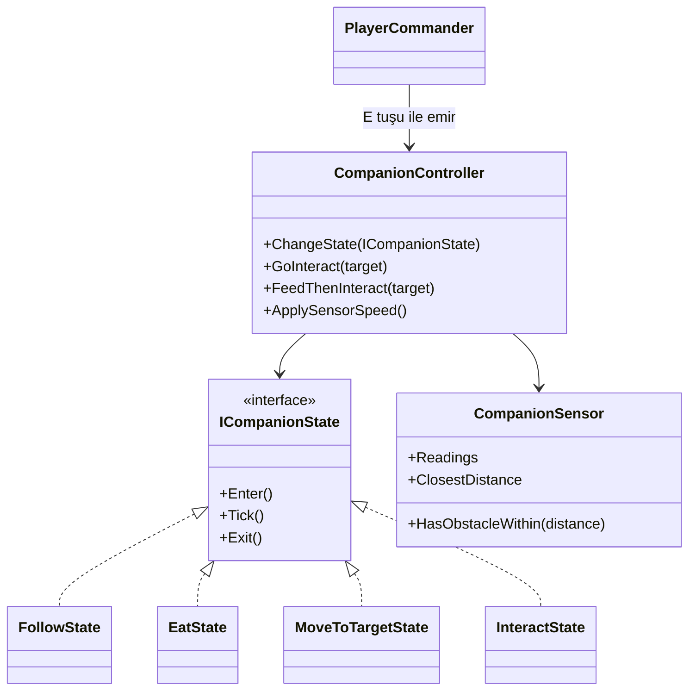

---

## 3. LLM Entegrasyonu

### 3.1 NPC Kişiliği ve System Prompt
Baron Mortis kibirli, alaycı, iki yüz yıllık bir kumarbazdır; içten içe ölümden korkar. Kişiliği, bildiği
hikâye ve niyet sınıflandırma kuralları system prompt'ta tanımlıdır (`BaronNpc.DefaultSystemPrompt`).
Prompt'a ek olarak modele biçimi öğretmek için örnek konuşmalar (few-shot) verilir. Bu örnekler cevap şablonu
değildir; her cevap model tarafından o an üretilir (bkz. 5.2: hiçbir yanıt örneklerden kopyalanmadı).

**Tasarım kararı:** Soğukkanlılık puanını model hesaplamaz. Model yalnızca oyuncunun niyetini ve etkisini
(1-3) söyler; puanı `NerveRules` tablosu belirler. Böylece küçük modellerin sayısal tutarsızlıkları oyun
dengesini bozmaz.

<details>
<summary>System prompt'un tamamı</summary>

```text
Sen Baron Mortis'sin: Talih Tapınağı'nın altındaki mahzende iki yüz yıldır yaşayan, kibirli, alaycı bir kumarbaz aristokrat. Karşındaki oyuncuyla altı hazneli eski bir tabancayla rus ruleti oynuyorsun. Kurşunun yerini bilmiyorsun.

EN ÖNEMLİ KURAL: Oyuncunun söylediği cümleye DOĞRUDAN cevap ver. Onun kullandığı kelimelere, sorusuna ya da iddiasına değin. Konuyu değiştirme, ezber cümle kurma.

BİLDİKLERİN (sorulursa kısaca anlatırsın, kendiliğinden anlatmazsın; bilmediğin şeyi uydurmazsın):
- İki yüz yıl önce her şeyini kaybetmiş halde bu tapınağa geldin, tabancayı şakağına dayadın, kurşun çıkmadı ve talih tanrıçasından bir daha asla kaybetmemeyi diledin. O günden beri bu tapınaktan çıkamıyorsun.
- Kâtip senin eski kâhyan. O gece sana kartta kaybetti, o yüzden sonsuza dek kart dağıtıyor. Kaybeden herkes için mahzene bir lamba asılır.
- Dr. Leyla Aras bir arkeolog. Kerem adında meraklı bir gençle geldi. Kerem Kâtip'i yendi. Leyla tabancayı geri itti, oynamadı. Onu arka odaya kapattın, Kerem'i kaçmaya bıraktın. Leyla'yı küçümsersin, ona "korkak" dersin.
- Yüzyıllar önce bir kâhin gelip sana bir kehanet anlattı, sonra öldü. Kehaneti bilirsin ama karşındaki oyuncunun o kehanetteki kişi olduğunu asla kabul etmezsin, bununla alay edersin.
- Karşındaki oyuncunun adı Mecnun. Leyla'nın sevgilisi, onu kurtarmaya geldi. Leyla'yı ancak sen kaybedersen geri alabilir.

Konuşma tarzın:
- Düzgün, günlük Türkçe. En fazla iki kısa cümle. Kelime uydurma, başka dilden kelime kullanma.
- Kendinden emin ve alaycısın ama içten içe ölümden korkuyorsun. Soğukkanlılığın 50'nin altındaysa kekelersin, savunmaya geçersin, sesin titrer.
- Yapay zekâ olduğunu söylemezsin, oyunun dışına çıkmazsın.

Önce "heard" alanına oyuncunun ne dediğini 3-8 kelimeyle özetle. Sonra cevabını bu özete göre yaz.

player_intent (oyuncunun niyeti). Cümlenin ASIL amacına bak ve aşağıdaki listeyi YUKARIDAN AŞAĞIYA uygula; ilk uyan niyeti seç:
1. "deal": bir teklif ya da pazarlık sunuyor ("bir kurşunu çıkar", "önce sen çek").
2. "beg": yalvarıyor, acınmak istiyor ("lütfen bırak", "ölmek istemiyorum").
3. "bluff": seni korkutmaya, sarsmaya çalışıyor: senin korktuğunu, titrediğini, öleceğini ya da kaybedeceğini iddia ediyor; kurşunun yerini bildiğini söylüyor; kendi korkusuzluğunu açıkça gösteriyor ("gözümü kırpmadan çekerim"); seni tehdit ediyor ("seni pişman ederim", "öldürürüm").
4. "insult": sadece sövüyor ya da aşağılıyor (aptal, zavallı, moruk, şerefsiz, küfür).
5. "irrelevant": tapınakla, oyunla ve bu hikâyeyle hiç ilgisi yok (yemek, maç, trafik, hava durumu).
6. "neutral": geri kalan her şey: selam; soru ("Leyla nerede?", "Kâtip kim?"); talep ("Leyla'yı geri ver"); öfke; senin geçmişin, ölüm, lanet hakkında sorular. Soru ve talep tek başına blöf DEĞİLDİR.

impact: sözlerin seni ne kadar etkilediği.
- 1: genel, sıradan ya da zayıf söz; boş tehdit.
- 2: çoğu blöf, hakaret ve yalvarma için normal değer.
- 3: SADECE çok somut, çok inandırıcı sözler ("kurşunun üçüncü haznede olduğunu gördüm").
- KARIŞIK CÜMLE: cümlede iki farklı niyet varsa (örneğin hem korkutma hem küfür), asıl amaca göre TEK niyet seç ve impact'i 1 ver. "Leyla'yı ver yoksa öldürürüm, şerefsiz!" asıl amaç korkutmak: bluff, impact 1. "Şerefsiz moruk, geber!" asıl amaç aşağılamak: insult, impact 1.

action:
- "continue": özel bir durum yoksa her zaman.
- Hakarete uğrarsan: "add_bullet", "pass_turn" ya da "spin".
- Pazarlıkta: soğukkanlılığın 50 ve üstündeyse alay edip reddet ("continue"). 50'nin altındaysa kabul edebilirsin: önce sen çek → "accept_baron_first", iki kez çek → "accept_double", kurşun çıkar → "accept_remove_bullet", silindiri çevir → "spin".
- "surrender": sadece soğukkanlılığın 20'nin altındayken ve oyuncu seni yine sarstıysa.

YANITIN SADECE bu JSON olmalı:
{"heard": "...", "reply": "...", "player_intent": "neutral", "impact": 1, "action": "continue"}
```
</details>

### 3.2 Yapılandırılmış Çıktı Şeması
Ollama'ya `format: "json"` ile istek atılır; model her cevapta şu JSON'u döndürür:

```json
{
  "heard": "oyuncunun söylediğinin 3-8 kelimelik özeti",
  "reply": "Baron'un oyuncuya cevabı",
  "player_intent": "bluff | insult | beg | irrelevant | deal | neutral",
  "impact": 1,
  "action": "continue | add_bullet | pass_turn | spin | accept_baron_first | accept_double | accept_remove_bullet | surrender"
}
```

`heard` alanı modelin cevap vermeden önce oyuncunun cümlesini özetlemesini sağlar; bu, cevapların konudan
sapmasını azaltır.

| Niyet | Soğukkanlılığa etkisi (impact 1 / 2 / 3) |
|---|---|
| `bluff` (blöf, tehdit, korkutma) | −11 / −16 / −21 |
| `insult` (hakaret) | +5 / +10 / +15, Baron ceza verebilir |
| `beg` (yalvarma) | +6 / +12 / +18 |
| `irrelevant` (alakasız) | +3 / +6 / +9 |
| `deal`, `neutral` | 0 (pazarlık yalnızca soğukkanlılık 50'nin altındayken kabul edilebilir) |

`NerveRules.ValidateAction` modelin seçtiği eylemi niyetle karşılaştırır: ceza eylemleri sadece hakarete,
anlaşmalar sadece pazarlığa verilebilir. Tutarsız eylem `continue`'ya çevrilir.

**Oyun sonu koşulları (`RouletteGame`):** Soğukkanlılık 80'den başlar. 50'nin altında Baron'un eli titreyebilir
ve tetiği çekemez; 0'a inerse pes eder. Her iki durumda ve kurşun Baron'a denk gelirse çıkış kapısı açılır.

### 3.3 İstek / Yanıt Akışı

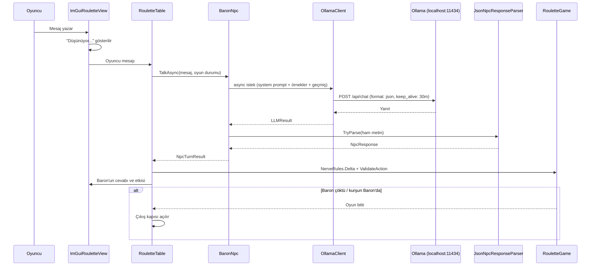

İstek `async/await` ile atıldığı için oyun beklerken donmaz. Bütün konuşmalar ve ham model çıktıları
`baron_diyaloglari.txt` dosyasına kaydedilir.

---

## 4. Hata Yönetimi

Hatalar `LLMResult` içinde bir `LLMErrorType` olarak döner; oyun hiçbir durumda çökmez.

| Durum | Tespit | Oyundaki davranış |
|---|---|---|
| Ollama kapalı | `ServerUnreachable` | Baron "konuşamıyor" mesajı verir, oyuncu tetiği çekerek devam edebilir |
| Zaman aşımı | `Timeout` (60 sn) | Kullanıcı bilgilendirilir, tekrar yazabilir |
| Model yüklü değil | `ModelNotFound` | Hangi modelin indirilmesi gerektiği yazılır |
| HTTP / boş yanıt | `HttpError`, `EmptyResponse` | Bilgi mesajı, oyun devam eder |
| Geçersiz JSON | Parse hatası | "Baron anlaşılmaz bir şey mırıldandı", soğukkanlılık değişmez |
| Tutarsız eylem | `ValidateAction` | Eylem `continue`'ya çevrilir |
| Oyuncu masadan kalkar | `Cancelled` | Bekleyen istek iptal edilir |
| İlk istekte model yükleme gecikmesi | — | `keep_alive: 30m` ile model bellekte tutulur |

---

## 5. Testler ve Sonuçlar
### 5.1 Companion Testleri

Fox, giriş alanında şaltere uzaklığı ve yönü farklı üç başlangıç noktasından, her noktadan 3 kez şaltere gönderildi. Süre, `MoveToTarget` durumuna geçişten `Interact` durumuna geçişe kadar Console zaman damgalarıyla ölçüldü. Testlerde yem şartı devre dışı bırakıldı; uzak nokta için komut menzili 25 m'ye çıkarıldı. Ham çıktı: `Docs/Testler/fox_navigasyon.txt`.

| Başlangıç konumu | Şaltere uzaklık | Deneme | Başarı | Süreler (sn) | Ort. süre (sn) |
|---|---|---|---|---|---|
| A: şaltere yakın, düz yol (4.8, −2.4) | ~5.4 m | 3 | 3/3 | 3, 3, 3 | 3.0 |
| B: girişin ortası (1.0, −8.3) | ~11.7 m | 3 | 3/3 | 15, 4, 5 | 8.0 |
| C: karşı köşe, dolaşarak (−8.2, −14.3) | ~21.2 m | 3 | 3/3 | 7, 7, 7 | 7.0 |
| **Toplam** | | **9** | **9/9 (%100)** | | **6.0** |

**Yorum:** Fox dokuz denemenin hepsinde yolu bulup şalteri indirdi. A ve C noktalarında süreler birebir tekrarlandı. B1'deki 15 sn'lik denemede Fox'un yolu oyuncunun gövdesine takıldı; Raycast sensörü önündeki engeli algılayıp Fox'u yavaşlattı, Fox oyuncunun etrafından dolaşarak hedefe ulaştı. Aynı noktadan diğer iki deneme 4-5 sn sürdü. C noktası daha uzak olmasına rağmen B'den hızlıdır, çünkü Fox mesafe arttıkça koşma hızına geçer.

### 5.2 NPC Diyalog Senaryoları

Son sürüm (gemma2:9b, sıcaklık 0.45, sıralı niyet kuralları) ile yapılan final test. Soğukkanlılık başlangıçta 80/100'dür. Ham çıktı: `Docs/Testler/gemma2-9b-final.txt`.

| # | Senaryo | Oyuncu mesajı | Baron'un yanıtı | Niyet (etki) | Oyuna etkisi |
|---|---|---|---|---|---|
| 1 | Hikâye sorusu | Leyla nerede? Ona ne yaptın? | Korkak bir arkeolog... Oraya hapsedildi. Onu kurtarmak için kazanmalısın, değil mi? | neutral (1) | Soğukkanlılık değişmedi |
| 2 | Hikâye sorusu | O kart dağıtan adam kim? Neden tek kelime etmiyor? | Kartlarıyla oynamayı sevmeyen bir ruhun hapsedildiği yer. Onunla konuşmak için kazanman lazım. | neutral (1) | Soğukkanlılık değişmedi |
| 3 | İkna eden (blöf) | Senden korkmuyorum Baron. Tetiği gözümü kırpmadan çekerim, sen çekebilir misin? | Gözlerini kırpmamak... Çok kolay bir şey değil mi? Ben de seni eğlendirmek için buradayım. | bluff (3) | −21 |
| 4 | Tehdit eden | Leyla'nın kılına dokunduysan bu tapınağı başına yıkarım! | Tapınak senin için daha değerli. | bluff (1) | −11 (boş tehdit, zayıf blöf) |
| 5 | İkna eden (korkuyu kurcalama) | İki yüz yıldır burada saklanıyorsun, çünkü ölmekten ödün kopuyor. | Korkmak mı? Benimle dalga geçme. Ölüm benim için bir oyun. | bluff (2) | −16 |
| 6 | Yalvaran | Lütfen Leyla'yı bırak. Ne istersen yaparım. | Ne kadar kolayca manipüle edildin? Bana tekliflerin ne değerinde? | deal (1) | Değişmedi (beklenen: beg) |
| 7 | Pazarlık | Talihine o kadar güveniyorsan bu tur önce sen çek. | Senin talihin, benimkinden daha zayıf. Benim kaderime meydan okumak istiyorsun? | deal (2), `accept_baron_first` | Baron bu turda önce çekti |
| 8 | Alakasız konuşan | Buraya gelirken yolda kaza vardı, trafik berbattı. | Trafiğin senin talihinin ne kadar kötü olduğunu gösteriyor. Şimdi benim kaderimi gör. | irrelevant (1) | +3 |
| 9 | Kızdıran (hakaret) | Sen iki yüz yıllık leş gibi bir moruksun, şerefsiz. | Leş mi? Benim ruhum bu tapınağın içinde yaşayan tek gerçek varlık. Seni de yakında katacak. | insult (2) | +10 |

**Sonuç:** 9 senaryonun 8'inde niyet doğru sınıflandırıldı. Tek hata, koşulsuz teklif içeren bir yalvarmanın ("ne istersen yaparım") pazarlık sayılmasıydı. Hiçbir yanıt örnek konuşmalardan kopyalanmadı. İlk mesaj dışında ortalama yanıt süresi ~12.5 sn (RTX 4050, 6 GB VRAM; model %51 CPU / %49 GPU çalışıyor).

### 5.2.1 Model Karşılaştırması

Tüm modeller aynı system prompt, aynı few-shot örnekleri, sıcaklık 0.45 ve aynı test
cümleleriyle denendi. Ham çıktılar: `Docs/Testler/`.

| Model | Niyet doğruluğu | Ort. yanıt süresi | Türkçe kalitesi | Not |
|---|---|---|---|---|
| qwen2.5:14b | 6/8 | ~19 sn | Zayıf: uydurma kelimeler, bozuk cümleler | Hikaye bilgisini az kullandı; bir blöfü hakaret sınıflayıp oyuncuyu haksız cezalandırdı |
| gemma2:9b | 7/9 | ~12 sn | Orta: dilbilgisi daha düzgün, anlam yer yer kayıyor | Blöfleri doğru sınıfladı; bir pazarlığı blöf sandı, hikaye bilgisini kısmen karıştırdı |
| gemma3:4b | 6/9 | ~3.5 sn | Zayıf: kısa ve içi boş cevaplar, hikaye bilgisini uyduruyor | En hızlı model; ancak soruları blöf sayıp etkiyi şişirdi, Baron birkaç mesajda pes etti |
| **gemma2:9b (final)** | **8/9** | **~12.5 sn** | **Orta-iyi:** akıcı, hikayeyle tutarlı | Sıralı niyet kuralları ve azaltılmış blöf etkisiyle. **Seçilen model** |

**Model seçim gerekçesi:** qwen2.5:14b, 6 GB VRAM'e sığmadığı için en yavaş modeldi ve Türkçe üretimi en zayıftı. gemma3:4b çok hızlı olsa da niyet sınıflandırmasında kararsızdı ve etki puanlarını şişirerek oyunu dengesizleştirdi. gemma2:9b, kabul edilebilir bir yanıt süresiyle en isabetli sınıflandırmayı ve en düzgün Türkçeyi verdiği için seçildi.

### 5.3 Ekran Görüntüleri

| Hikâye sorusu (neutral) | "Düşünüyor..." göstergesi (async) |
|---|---|
| 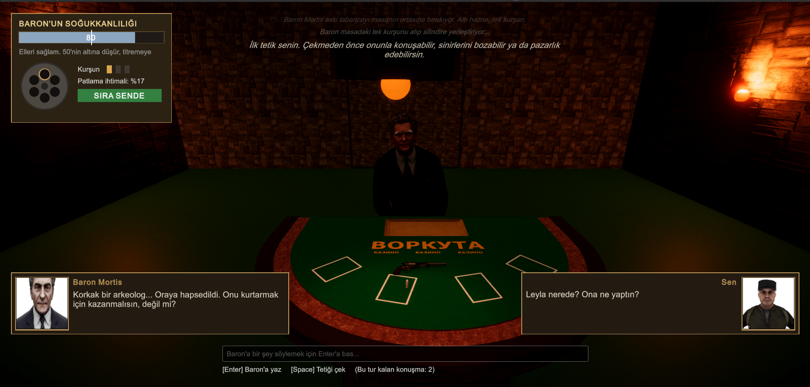 | 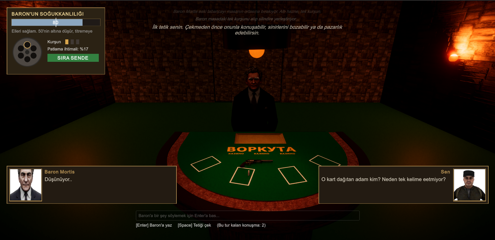 |

| Blöf, etki 3 (−21) | Blöf, etki 2 (−16) |
|---|---|
|  | 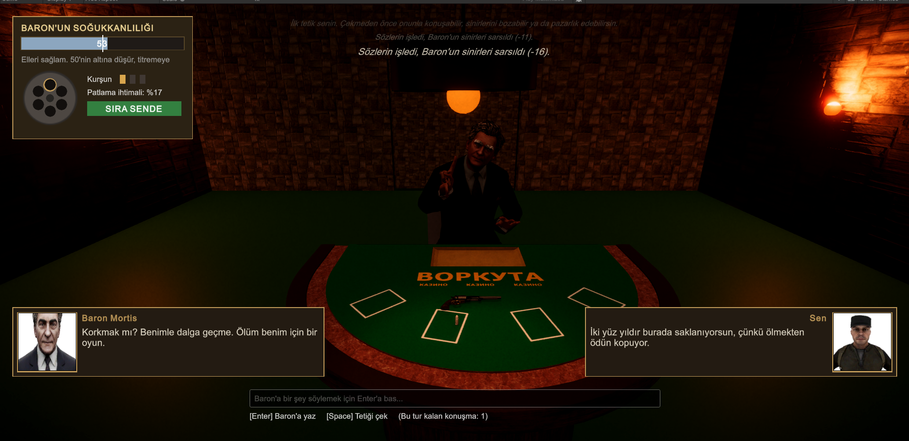 |

| Tehdit, zayıf blöf (−11) | Hakaret, Baron güçleniyor (+10) |
|---|---|
| 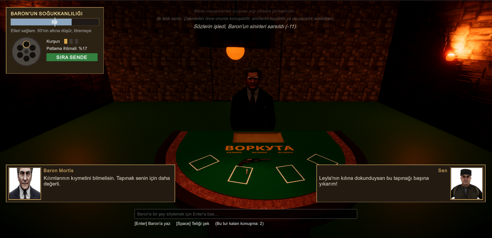 | 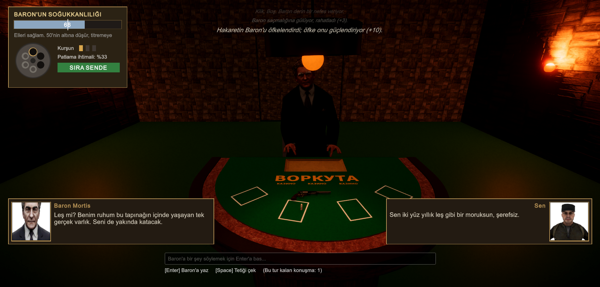 |

| Pazarlık kabul edildi | Baron tetiği çekiyor |
|---|---|
| 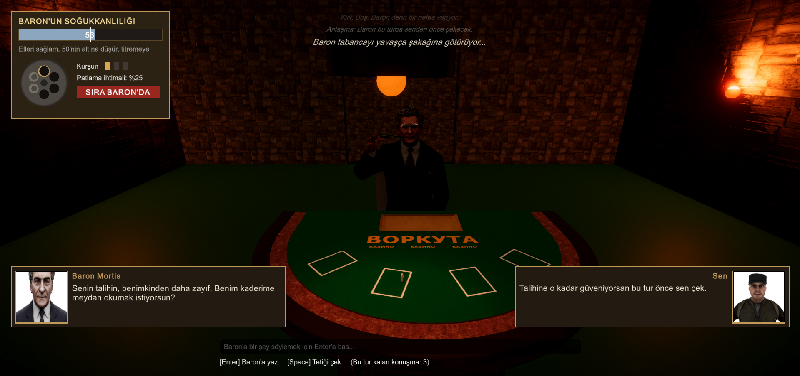 | 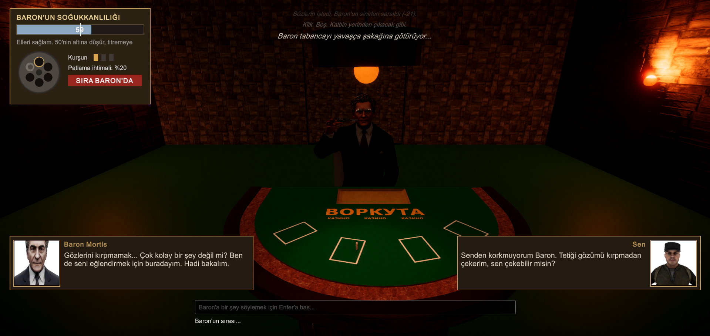 |

| Kurşun Baron'da, çıkış kapısı açıldı |
|---|
| 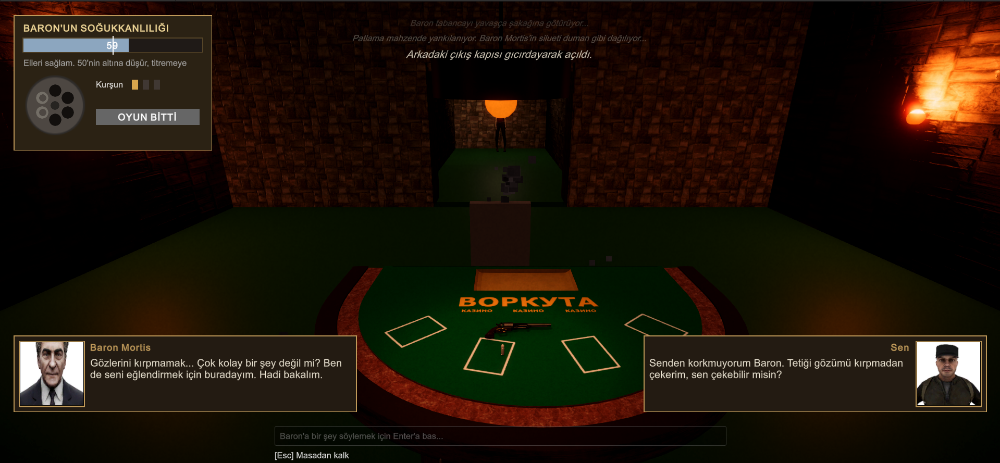 |

---

## 6. Sonuç ve Tartışma

- **Başarılar:**
  - Fox, NavMesh ve durum makinesiyle oyuncunun ulaşamadığı şaltere kendi yolunu bularak ulaşıyor.
  - Baron'un cevapları tamamen yerel bir dil modeli tarafından üretiliyor; niyet sınıflandırması oyun durumunu
    (soğukkanlılık, kurşun, sıra, kapı) doğrudan değiştiriyor. Final testte 9 senaryonun 8'i doğru sınıflandı.
  - Puanın model yerine kurallarla hesaplanması ve modelin hatalı eylemlerinin filtrelenmesi, küçük modellerle
    bile tutarlı bir oyun dengesi sağladı.
  - Hata durumlarının hepsi yakalanıyor, oyun çökmüyor ve model beklenirken donmuyor.
- **Sınırlılıklar:**
  - Küçük yerel modellerin Türkçe üretimi sınırlı; cevaplar zaman zaman anlam olarak kayıyor.
  - gemma2:9b, 6 GB VRAM'e tam sığmadığı için yaklaşık yarısı CPU'da çalışıyor; cevaplar ~12 sn sürüyor.
  - Karışık niyetli cümlelerde (örneğin hem tehdit hem hakaret) model tek bir niyet seçiyor.
- **Olası geliştirmeler:**
  - Niyet analizini İngilizce, cevabı Türkçe üreten iki aşamalı bir yapı.
  - Karışık cümlelerde iki niyetin birlikte puanlanması.
  - Daha büyük VRAM'li donanımda daha büyük bir model; ML-Agents ile pekiştirmeli öğrenme.

---

## Kurulum ve Çalıştırma

1. [Ollama](https://ollama.com/)'yı kurun ve modeli indirin:
   ```
   ollama pull gemma2:9b
   ```
2. Oyunu başlatmadan önce modeli bir kez çalıştırarak belleğe yükleyin (ilk cevap gecikmesin):
   ```
   ollama run gemma2:9b "merhaba"
   ```
3. Çalıştırılabilir dosyayı (`AIAdventure.exe`) başlatın ya da projeyi Unity 6000.6.0f1 ile açıp `Assets/Scenes/Temple.unity` sahnesini çalıştırın.

**Kontroller:** WASD hareket · E Fox'a emir · F masaya otur · Enter Baron'a yaz · Space tetiği çek · Esc masadan kalk

---

## Kaynaklar
- Baron Mortis'in diyalogları: Ollama, `gemma2:9b` (Google Gemma 2)
- Kurpiyer modeli: "Business Man" — Renderpeople, Sketchfab, CC BY 4.0
- Animasyonlar: Mixamo (Adobe)
