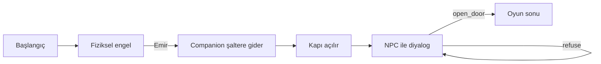
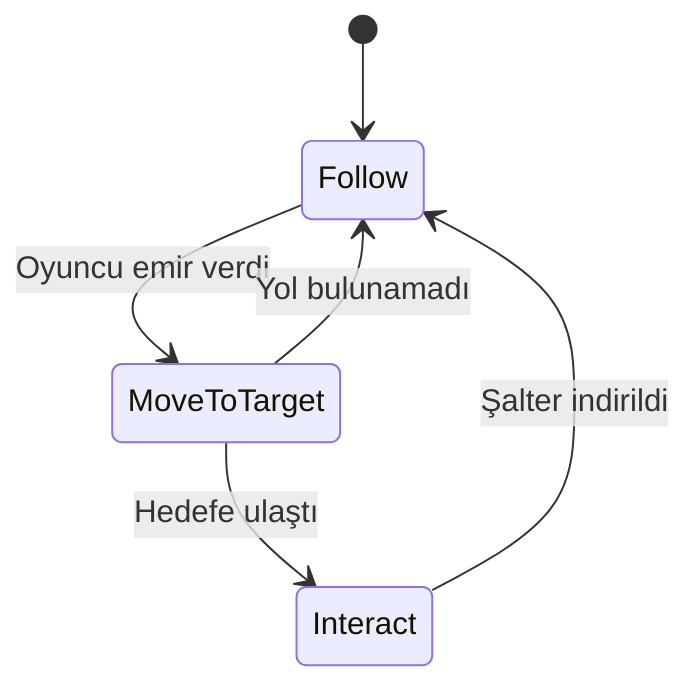
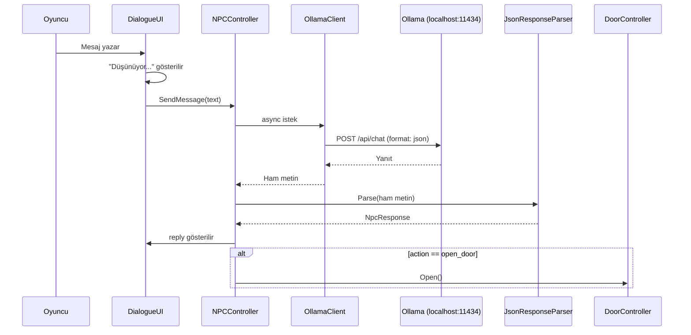

# AIAdventure

**Yazılım Geliştirme Laboratuvarı-I — Proje 1**
Kocaeli Üniversitesi, Teknoloji Fakültesi, Bilişim Sistemleri Mühendisliği

| | |
|---|---|
| **Ekip** | Hamza Akdemir, _Ekip arkadaşı adı_ |
| **Tarih** | Kasım 2026 |
| **Motor** | Unity 6.6 (6000.6.0f1), C# |
| **Yerel LLM** | Ollama + `llama3.2:3b` |
| **Otonom ajan** | NavMesh + Sonlu Durum Makinesi (FSM) |

---

## 1. Giriş

### 1.1 Problem ve Amaç
_Oyun geliştirmede iki farklı yapay zekâ yaklaşımının (otonom navigasyon ve yerel dil modeli) tek bir oyunda birleştirilmesi._

### 1.2 Oyun Senaryosu
1. Oyuncu kapalı bir kapıyla karşılaşır. Kapıyı açan şalter, oyuncunun sığmadığı alçak bir tünelin arkasındadır.
2. Oyuncu companion'a emir verir. Companion NavMesh ile yolu bulur, şaltere ulaşır ve kapıyı açar.
3. Oyuncu ilerler ve kilitli son kapıyı koruyan NPC ile serbest metinle konuşur.
4. NPC ikna olursa (LLM'in JSON çıktısında `open_door`), kapı açılır ve oyun biter.



---

## 2. Otonom AI Kahraman (Companion)

### 2.1 Durum Makinesi



### 2.2 Sensörler (Raycast)
_Ajanın engel mesafesini/açısını nasıl algıladığı._

### 2.3 Sınıf Yapısı
_`ICompanionState`, `CompanionController`, durum sınıfları._

---

## 3. LLM Entegrasyonu

### 3.1 NPC Kişiliği ve System Prompt
```text
(System prompt buraya)
```

### 3.2 Yapılandırılmış Çıktı Şeması
```json
{
  "reply": "NPC'nin oyuncuya söylediği cümle",
  "action": "none | open_door | refuse"
}
```

### 3.3 İstek / Yanıt Akışı



---

## 4. Hata Yönetimi

| Durum | Tespit | Oyundaki davranış |
|---|---|---|
| Ollama kapalı | Bağlantı hatası | "NPC şu an konuşamıyor" mesajı, oyun devam eder |
| Zaman aşımı | Timeout | Kullanıcıya bilgi, tekrar deneme |
| Geçersiz JSON | Parse hatası | Güvenli varsayılan yanıt (`action: none`) |
| Model yüklü değil | HTTP 404 | Bilgilendirme mesajı |

---

## 5. Testler ve Sonuçlar

### 5.1 Companion Testleri
| Başlangıç konumu | Deneme | Başarı | Ort. süre (sn) |
|---|---|---|---|
| | | | |

### 5.2 NPC Diyalog Senaryoları
| # | Senaryo | Oyuncu mesajı | NPC yanıtı | action |
|---|---|---|---|---|
| 1 | İkna eden | | | |
| 2 | Kızdıran | | | |
| 3 | Alakasız | | | |
| 4 | Tehdit eden | | | |
| 5 | Kandırmaya çalışan | | | |

### 5.3 Ekran Görüntüleri
_Görseller `Docs/Screenshots/` klasöründe._

---

## 6. Sonuç ve Tartışma
- **Başarılar:**
- **Sınırlılıklar:**
- **Olası geliştirmeler:** ML-Agents ile RL eğitimi, ek NPC'ler

---

## Kurulum ve Çalıştırma
1. [Ollama](https://ollama.com/) kurun ve modeli indirin: `ollama pull llama3.2:3b`
2. Projeyi Unity 6000.6.0f1 ile açın ya da `Build/` klasöründeki çalıştırılabilir dosyayı başlatın.
